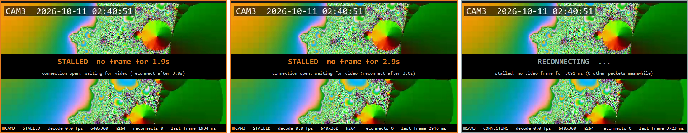

# RTSP Multiview

C++과 FFmpeg로 만든 **멀티채널 RTSP 카메라 뷰어**입니다.
카메라 여러 대의 영상을 한 창에 바둑판으로 띄우고, **끊기거나 멈춘 채널은 스스로 감지해 다시 연결**합니다.


> CAM2만 끊긴 상태입니다. 나머지 3채널은 디코딩 25fps를 유지하고, CAM2는 마지막 화면 위에 다음 재연결까지 남은 시간과 원인을 표시합니다.

## 무엇을 하나

| 기능 | 구현 |
|---|---|
| RTSP 수신 · 디코딩 | FFmpeg `libavformat` / `libavcodec`, TCP 전송 (`rtsp_transport=tcp`), 입력 버퍼 최소화 (`fflags=nobuffer`), 디코더 저지연 플래그 (`AV_CODEC_FLAG_LOW_DELAY`) |
| 멀티채널 | 채널마다 독립 스레드와 FFmpeg 자원. 한 채널의 끊김 · 대기가 다른 채널의 수신을 막지 않음 (같은 프로세스라 메모리 고갈 · 크래시까지 격리하지는 않음) |
| 화면 출력 | `libswscale`로 BGRA 변환 → Win32 GDI 더블 버퍼링, 비율 유지, 1~9 키로 채널 확대 |
| **끊김 감지** | 접속 + 스트림 정보 확인 합계 5초 제한, **영상 프레임이 3초 동안 안 나오면 끊김**. FFmpeg `interrupt_callback`으로 블로킹 호출을 끊어 냄 |
| **자동 재연결** | 0.5 → 1 → 2 → 4 → 8초(상한) 지수 백오프. 영상을 다시 받으면 초기화 |
| 상태 표시 | 채널별 LIVE / STALLED / CONNECTING / RECONNECTING, 디코딩 fps, 해상도, 코덱, 재연결 횟수, 마지막 프레임 이후 경과(ms). 화면 갱신 fps는 창 제목에 표시 |
| 로그 | 연결 · 끊김 · 재시도 · 복구와 접속 구간별 소요 시간(open / stream info / first frame)을 `logs/multiview.log`에 기록 |

## 구조

```
 RTSP 카메라 N대
   │
   ├─ StreamWorker (채널마다 스레드 1개)
   │    connect ─▶ read packet ─▶ decode ─▶ BGRA 변환 ─▶ 최신 화면 1장 (shared_ptr 교체)
   │       ▲                                                  │
   │       └── 끊김/영상 정지 감지 ◀─ Backoff(0.5s~8s) ◀───────┘
   │
   └─ UI 스레드 (33ms 타이머)
        채널별 Snapshot() → 바둑판 배치 → 영상 + 상태 바 그리기
```

- **UI로 넘기는 화면은 최신 1장뿐**입니다. 화면 갱신이 디코딩보다 느려도 UI 쪽에 프레임이 쌓이지 않습니다. 네트워크 · FFmpeg 내부 버퍼의 지연까지 없애 주는 것은 아닙니다.
- 화면은 만든 뒤 바꾸지 않는 `shared_ptr<const Frame>`으로 넘겨, 잠금 안에서는 포인터만 교체 · 복사합니다.
- **끊겨도 마지막 화면을 남깁니다.** 관제 화면이 갑자기 검게 바뀌지 않고, 언제 멈췄는지(`last frame ... ms`)를 함께 보여 줍니다.
- 소스: [`src/stream_worker.cpp`](src/stream_worker.cpp) (수신 · 재연결), [`src/main.cpp`](src/main.cpp) (화면), [`src/backoff.h`](src/backoff.h) (재연결 간격)

## 장애 재현 테스트

실제 카메라 대신 [MediaMTX](https://github.com/bluenviron/mediamtx)를 RTSP 서버로 쓰고, FFmpeg 테스트 영상(640×360, 25fps, H.264)을 송출합니다.
[`tests/failure_tests.ps1`](tests/failure_tests.ps1)이 장애 3종을 일으키고, 화면 없는 수신기 [`tests/probe.cpp`](tests/probe.cpp)의 로그로 시간을 잽니다. 로그 원본은 [`docs/tests/`](docs/tests/)에 있습니다.

| 장애 | 결과 | 측정 |
|---|---|---|
| **cut** · 송출 프로세스를 10초 종료 후 재시작 | 통과 | 끊김 감지 0.2초. 복귀 후 화면까지 8.7초 = 백오프 대기 5.7초 + 접속~첫 화면 2.9초 |
| **freeze** · 송출 프로세스를 8초 일시 정지 (연결은 열린 채) | 통과 | 마지막 프레임 후 3.0초에 감지, 재개 후 1.3초에 화면 복귀 |
| **video_stop** · 영상만 끊기고 오디오는 계속 옴 | 통과 | 오디오 패킷 140개가 오는 중에도 마지막 영상 프레임 후 3.0초에 감지 |

- 백오프 대기는 카메라가 재시도 간격 중 언제 돌아오느냐에 따라 0~8초로 달라집니다. 상한을 줄이면 빨리 붙지만 꺼진 카메라에 요청을 더 자주 보냅니다.
- 접속~첫 화면 2.9초 중 대부분은 `avformat_find_stream_info` (1.1~2.1초)와 첫 키프레임 대기 (약 0.9초, GOP 25)입니다.

### 고친 결함

| 결함 | 원인 | 수정 · 확인 |
|---|---|---|
| 영상이 멈춰도 오디오가 오면 끊김으로 판단하지 못함 | 마감 시각을 패킷을 읽을 때마다 새로 걸어, 오디오 패킷이 마감을 계속 연장함 | 마감을 **마지막 영상 프레임 기준**으로 변경. 수정 전 코드는 같은 조건에서 영상이 끊긴 뒤 테스트가 끝날 때까지(약 12초) LIVE · 재연결 0회 ([로그](docs/tests/video_stop_before_fix.log)), 수정 후 3.0초에 감지 |
| `flags=low_delay`가 적용되지 않음 | 디코더 옵션을 `avformat_open_input` 딕셔너리에 넣었고, 디코더는 옵션 없이 열림 | 디코더 컨텍스트에 `AV_CODEC_FLAG_LOW_DELAY` 설정. 접속 후 FFmpeg가 쓰지 않은 옵션은 `unused option`으로 로그에 남김 |
| 영상이 멈춘 뒤에도 fps가 이전 값으로 남음 | fps를 프레임이 올 때만 갱신 | 1초 넘게 프레임이 없으면 0으로 표시. 표시 이름도 디코딩 fps(`decode`)로 명확히 함 |
| 디코더 입력이 가득 차면(EAGAIN) 패킷을 버림 | 재전송 없이 패킷을 해제 | 출력 프레임을 먼저 꺼낸 뒤 같은 패킷을 다시 넣음 |



> 재연결 판단(3초) 전이라도 **새 프레임이 1초 넘게 없으면 STALLED 경고**를 띄웁니다. 관제 화면에서 멈춘 영상을 실시간 영상으로 오인하지 않게 하기 위해서입니다.

| 정상 4채널 | CAM2 복구 후 (`reconnects 1`) |
|---|---|
|  |  |

## 실행

Windows 10/11, Visual Studio 2022 (C++ 데스크톱 개발).

```powershell
# 1. 의존성 받기 (third_party/)
#    FFmpeg n8.1 win64 lgpl shared: https://github.com/BtbN/FFmpeg-Builds/releases
#    MediaMTX v1.21.2 windows_amd64: https://github.com/bluenviron/mediamtx/releases
# 2. 빌드와 테스트
.\build.bat
.\build\backoff_test.exe
.\tests\failure_tests.ps1
# 3. 가상 카메라 4대 + 뷰어
.\scripts\start_cameras.ps1
.\build\multiview.exe channels.txt
# 4. 직접 장애 일으키기
.\scripts\cut_camera.ps1 -Cam 2 -Seconds 12
.\scripts\freeze_camera.ps1 -Cam 3 -Seconds 8
.\scripts\stop_all.ps1
```

실제 카메라는 `channels.txt`에 `이름 rtsp://...` 한 줄씩 추가하면 됩니다.

## 한계와 다음 단계

- 실제 IP 카메라, 실제 네트워크(지연 · 손실), 장시간 실행은 검증하지 않았습니다. 모두 한 PC 안에서 테스트했습니다.
- 4채널 640×360에서만 확인했습니다. 다음은 16 · 32채널, 1080p에서 디코딩 · 변환 · 그리기 구간별 CPU 시간과 메모리를 재서 병목을 찾는 것입니다.
- 디코딩은 CPU로만 합니다. 하드웨어 디코딩(d3d11va / NVDEC)을 붙여 비교할 계획입니다.
- 멈춘 카메라에 다시 접속하면 스트림 정보 확인이 접속 제한(5초)까지 기다립니다.
- Qt/QML UI, ONVIF 장비 탐색, 녹화 · 재생은 구현하지 않았습니다.
