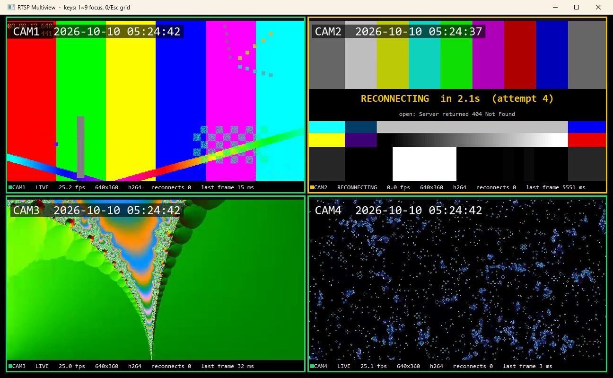
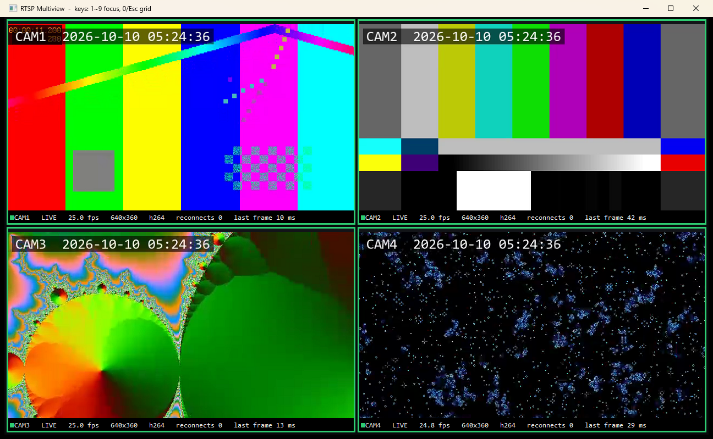
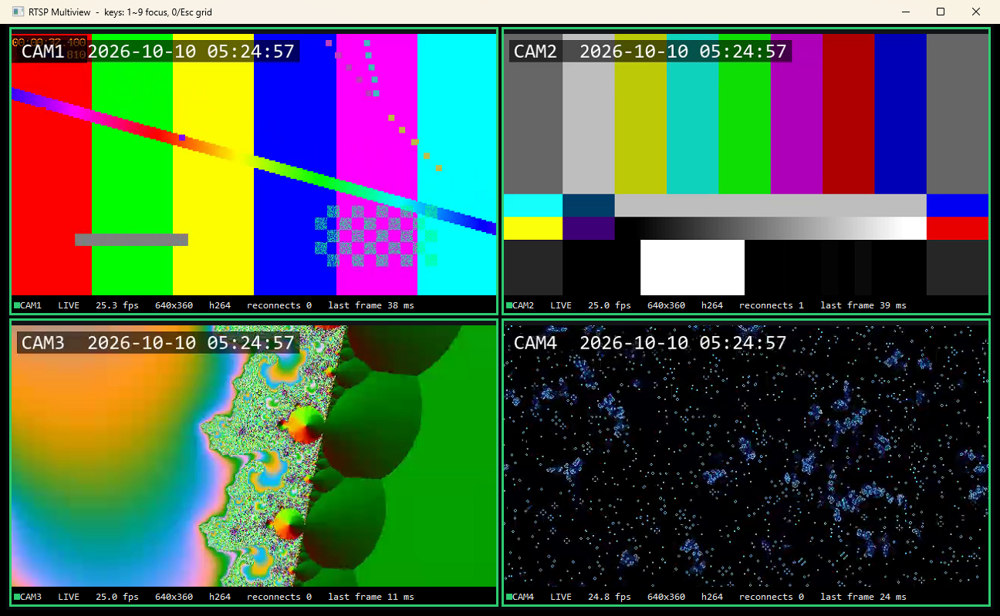

# RTSP Multiview

C++과 FFmpeg로 만든 **멀티채널 RTSP 카메라 뷰어**입니다.
카메라 여러 대의 영상을 한 창에 바둑판으로 띄우고, **끊기거나 멈춘 채널은 스스로 감지해 다시 연결**합니다.



> CAM2만 끊긴 상태입니다. 나머지 3채널은 영향 없이 25fps를 유지하고, CAM2는 마지막 화면 위에 재연결 대기 시간과 원인을 표시합니다.

## 무엇을 하나

| 기능 | 구현 |
|---|---|
| RTSP 수신 · 디코딩 | FFmpeg `libavformat` / `libavcodec`, TCP 전송 (`rtsp_transport=tcp`), 저지연 옵션 (`nobuffer`, `low_delay`) |
| 멀티채널 | 채널마다 독립 스레드. 한 채널의 장애가 다른 채널에 번지지 않음 |
| 화면 출력 | `libswscale`로 BGRA 변환 → Win32 GDI 더블 버퍼링, 비율 유지, 1~9 키로 채널 확대 |
| **끊김 감지** | 접속 5초, 패킷 대기 3초 상한. FFmpeg `interrupt_callback`으로 블로킹 호출을 끊어 냄 |
| **자동 재연결** | 0.5 → 1 → 2 → 4 → 8초(상한) 지수 백오프. 영상을 다시 받으면 초기화 |
| 상태 표시 | 채널별 LIVE / CONNECTING / RECONNECTING, fps, 해상도, 코덱, 재연결 횟수, 마지막 프레임 이후 경과(ms) |
| 로그 | 연결 · 끊김 · 재시도 · 복구를 밀리초 단위 시각과 함께 `logs/multiview.log`에 기록 |

## 구조

```
 RTSP 카메라 N대
   │
   ├─ StreamWorker (채널마다 스레드 1개)
   │    connect ─▶ read packet ─▶ decode ─▶ BGRA 변환 ─▶ 최신 프레임 1장만 보관
   │       ▲                                                  │
   │       └── 끊김/무응답 감지 ◀─ Backoff(0.5s~8s) ◀──────────┘
   │
   └─ UI 스레드 (33ms 타이머)
        채널별 Snapshot() → 바둑판 배치 → 영상 + 상태 바 그리기
```

- **최신 프레임 1장만 보관**합니다. 화면이 디코딩보다 느려도 프레임이 쌓이지 않아 지연이 늘지 않습니다.
- **끊겨도 마지막 화면을 남깁니다.** 관제 화면이 갑자기 검게 바뀌지 않고, 언제 멈췄는지(`last frame ... ms`)를 함께 보여 줍니다.
- 소스: [`src/stream_worker.cpp`](src/stream_worker.cpp) (수신 · 재연결), [`src/main.cpp`](src/main.cpp) (화면), [`src/backoff.h`](src/backoff.h) (재연결 간격)

## 장애 재현 결과

실제 카메라 대신 [MediaMTX](https://github.com/bluenviron/mediamtx)를 RTSP 서버로 쓰고, FFmpeg 테스트 영상 4개(640×360, 25fps, H.264)를 송출해 확인했습니다.

**1. 카메라가 꺼졌다가 12초 뒤 돌아옴** (`scripts/cut_camera.ps1`)

```
05:24:37.353  [CAM2]  lost: read: End of file
05:24:37.355  [CAM2]  retry #1 in 500 ms (read: End of file)
05:24:37.928  [CAM2]  retry #2 in 1000 ms (open: Server returned 404 Not Found)
05:24:38.974  [CAM2]  retry #3 in 2000 ms (open: Server returned 404 Not Found)
05:24:40.995  [CAM2]  retry #4 in 4000 ms (open: Server returned 404 Not Found)
05:24:45.052  [CAM2]  retry #5 in 8000 ms (open: Server returned 404 Not Found)
05:24:55.286  [CAM2]  LIVE 640x360 h264
```

- 끊김은 즉시 감지했고, 다른 3채널은 그동안 25fps를 유지했습니다.
- 카메라 복구(05:24:49.6) 후 다음 재시도 시점에 다시 연결돼 약 5.7초 뒤 화면이 돌아왔습니다. 재시도 간격 상한(8초)과 복구 속도 사이의 절충이며, 상한을 줄이면 더 빨리 붙는 대신 꺼진 카메라에 요청을 더 자주 보냅니다.

**2. 연결은 열린 채 카메라가 응답 없이 멈춤** (`scripts/freeze_camera.ps1`)

```
05:25:46.849  CAM3 frozen for 8 s
05:25:52.893  [CAM3]  lost: stalled: no packet for 3000 ms
05:25:53.446  [CAM3]  connecting rtsp://127.0.0.1:8554/cam3
05:25:57.510  [CAM3]  LIVE 640x360 h264
```

- 소켓은 살아 있어 오류가 나지 않는 경우입니다. 패킷 대기 시간에 상한을 둬서 멈춤을 끊김으로 판단하고 다시 연결했습니다.
- 멈춘 뒤 감지까지 약 6초가 걸렸습니다. 서버와 소켓 버퍼에 남아 있던 영상이 먼저 소진되고, 그 뒤 3초 동안 패킷이 없어야 감지되기 때문입니다.

| 정상 4채널 | CAM2 복구 후 (`reconnects 1`) |
|---|---|
|  |  |

## 실행

Windows 10/11, Visual Studio 2022 (C++ 데스크톱 개발).

```powershell
# 1. 의존성 받기 (third_party/)
#    FFmpeg n8.1 win64 lgpl shared: https://github.com/BtbN/FFmpeg-Builds/releases
#    MediaMTX v1.21.2 windows_amd64: https://github.com/bluenviron/mediamtx/releases
# 2. 빌드
.\build.bat
.\build\backoff_test.exe
# 3. 가상 카메라 4대 + 뷰어
.\scripts\start_cameras.ps1
.\build\multiview.exe channels.txt
# 4. 장애 재현
.\scripts\cut_camera.ps1 -Cam 2 -Seconds 12
.\scripts\freeze_camera.ps1 -Cam 3 -Seconds 8
.\scripts\stop_all.ps1
```

실제 카메라는 `channels.txt`에 `이름 rtsp://...` 한 줄씩 추가하면 됩니다.

## 다음 단계

- 하드웨어 디코딩 (`hwaccel` d3d11va / NVDEC)으로 채널 수 확장과 CPU 사용량 비교
- 채널 수를 늘린 부하 측정 (16 · 32채널에서 fps, CPU, 메모리)
- ONVIF 장비 탐색과 PTZ 제어
- Qt/QML로 UI 이전, 녹화와 재생
